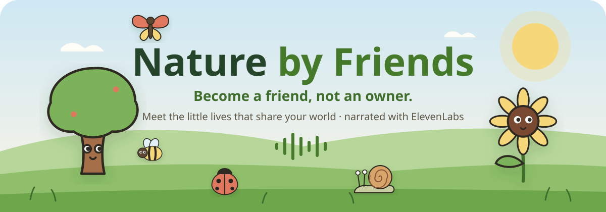
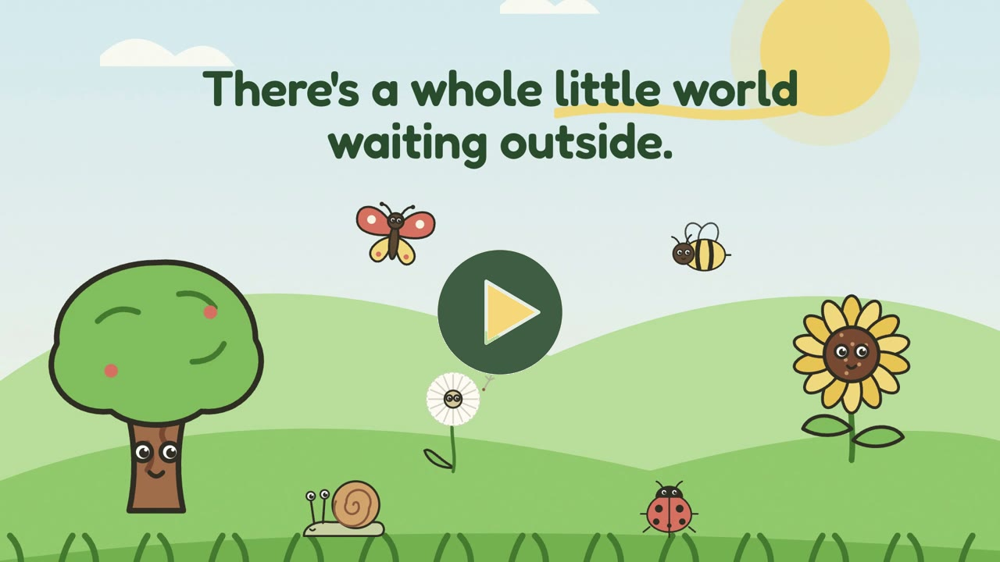
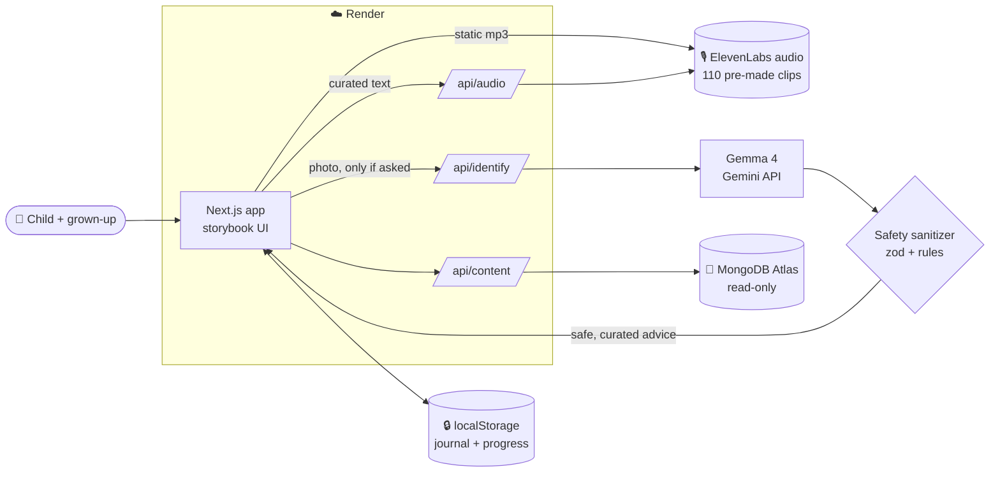

<div align="center">



# 🌱 Nature by Friends

### *Become a friend, not an owner.*

**A storybook nature adventure for kids aged 6–10.** Meet twenty little neighbours, get a tiny outdoor mission,<br/>
put the phone away, and come back to save a nature memory. The whole app is narrated in one warm voice made with **ElevenLabs**.

<br/>

[](https://nature-by-friends-axjw.onrender.com)
&nbsp;
[](https://elevenlabs.io)
&nbsp;
[](https://render.com)


<sub>Built for <b>MLH Global Hack Week: Hacktoberfest</b> · theme <b>“Touch Grass”</b></sub>

<br/>

### 🎬 Watch the 60-second film

<a href="https://nature-by-friends-axjw.onrender.com/film.mp4"></a>

<sub>Narrated in the app's own ElevenLabs voice · real product footage · 1920×1080 · <a href="https://nature-by-friends-axjw.onrender.com/film.mp4">▶ play</a> · <a href="public/film.mp4">file in repo</a></sub>

</div>

---

## 🍃 The idea

Most nature apps turn animals into things to **collect**. Nature by Friends turns them into neighbours to **befriend**.

> A child picks a friend (say, Millie the Earthworm), learns how to give it space, **puts the phone down**, and goes outside with a trusted adult. When they come back, they tell their journal what they noticed. Not finding anything is completely okay. There are no points, no streaks and no timers.

<table>
<tr>
<td width="33%" align="center">👀<br/><b>Look, don't touch</b><br/><sub>Friends give each other space</sub></td>
<td width="33%" align="center">🏡<br/><b>Their home stays their home</b><br/><sub>No catching, keeping or peeking in nests</sub></td>
<td width="33%" align="center">🌈<br/><b>No finding is fine</b><br/><sub>Noticing is enough</sub></td>
</tr>
</table>

---

## 🎙️ Powered by ElevenLabs

<div align="center">

**ElevenLabs is the soul of this app.** Children 6–10 aren't all strong readers, and a mission you can *hear* is a mission you can do with the phone in your pocket. So every word and every sound comes to life through one warm narrator voice and a garden full of ElevenLabs-made sound.

</div>

<br/>

<table>
<tr>
<th width="34%">🗣️ Text-to-Speech, one narrator voice</th>
<th width="33%">🐦 Sound Effects API</th>
<th width="33%">🎧 Designed audio experiences</th>
</tr>
<tr valign="top">
<td>

- **Listen to your mission:** every mission read aloud before you head outside
- **Read-aloud** for all 20 profiles and 20 Tiny Nature Stories
- **9-slide guided tour**, fully narrated
- **Sound Safari reveals:** *“That was the sparrow! Sparrows chirp to stay in touch with their group.”*
- **The Quiet Minute:** a guided outdoor listening exercise

</td>
<td>

- **Living soundscape:** 3 seamless loops (chirpy garden, rain on soil, evening crickets) that change with the page you're on
- **Hear me:** the real call of every animal friend: buzz, chirp, coo, caw, croak, chatter
- **Honest for quiet friends:** worms, snails and moss don't make sounds, so you hear *where they live*, and the label says so

</td>
<td>

- **Sound Safari:** hear a sound, guess the friend, the narrator reveals a fact (no points, no timer)
- **Quiet Minute:** 9 narrated parts with real silences, where the garden sound comes back up so children truly listen
- **Ducking:** the soundscape softens whenever the narrator speaks
- **One voice at a time:** a shared voice channel means nothing ever talks over anything else

</td>
</tr>
</table>

<div align="center">

| | |
|:--|:--|
| 🎵 **110 audio files** | **87** narrated voice clips + **23** sound-effect clips |
| 🗣️ **One consistent voice** | ElevenLabs voice `EeQEodFZVtBkjtgK3HBc`, model `eleven_multilingual_v2` |
| 💸 **Zero runtime credits** | Everything is generated **once** by script and served as static files, so visitors never spend credits |
| 🛡️ **Abuse-proof API** | `/api/audio` only narrates sentences that exist in the app's own curated content |
| 📱 **Never a dead end** | If audio can't play, the device's voice takes over, and the text is always on screen |

</div>

```bash
npm run audio:generate    # narration for profiles, missions and stories (Text-to-Speech)
npm run sounds:generate   # soundscape, creature sounds, Sound Safari, Quiet Minute, tour (TTS + Sound Effects)
```
<sub>Both scripts skip files that already exist, so re-running costs nothing.</sub>

---

## ✨ Features

| | Feature | What it does |
|:-:|---|---|
| 🧭 | **Guided 3D tour** | First-visit tour of every feature: a 3D paper stage that tilts with your pointer, page-flip transitions, narration, a bouncing arrow when the voice finishes, and **Skip** at any time |
| 🌼 | **Nature Garden** | 20 hand-drawn friends (bees, frogs, moss, mushrooms…) with search, filters and *Surprise me* |
| 🐞 | **Friend profiles** | True facts, habitat, why it matters, safe watching, *please don't*, related friends, read-aloud and *Hear me* |
| 🗺️ | **Become a Friend missions** | Six steps: Meet → Discover → Respect → **Phone down, eyes up** → Reflect → Remember. Resumes if you close the app |
| 📸 | **Photo helper** | Optional photo → **Gemma 4** makes a *cautious* guess (“might be…”). Unsafe advice is replaced; risky creatures say *ask a trusted adult* |
| 🎧 | **Listening Corner** | Sound Safari and the Quiet Minute |
| 📔 | **Nature Journal** | Saved only in your browser: timeline, photos, **return visits** with *Then and now*, download as text |
| 🌱 | **My nature progress** | Friends met (20), missions, return visits, sounds learned, quiet minutes. Gentle, never a score |
| 🕸️ | **Friendship Web** | Interactive ecosystem map of all 20 friends plus sun, pond, leaves and soil, with **37** curated connections |
| 📖 | **Tiny Nature Stories** | 20 stories where 🍃 marks real facts and ✨ marks imagination |
| 👨‍👩‍👧 | **For grown-ups** | Safety, AI limits, privacy, and **Delete all my data** |

---

## ☁️ Deployed on Render

<table>
<tr>
<td>

**🌐 Live:** **https://nature-by-friends-axjw.onrender.com**

- **Web service:** Node web service, Oregon, deploys automatically on every push to `main`
- **Health check:** `/api/health`, which reports which services are configured and costs nothing to call
- **Blueprint:** `render.yaml` holds the full service definition, so deploying is one click
- **Cloudflare edge:** rate limits use Render's unspoofable `CF-Connecting-IP`
- **Always awake:** an UptimeRobot ping to `/api/health` every 5 minutes keeps the free instance from sleeping
- **Secrets:** set in Render's dashboard only, never in the repo

</td>
</tr>
</table>

```text
Render → New → Blueprint → select this repo → add secrets → Deploy
```

---

## 🧰 Tech stack

<div align="center">

| Layer | Technology |
|---|---|
| **Voice & sound** | 🎙️ **ElevenLabs**: Text-to-Speech (`eleven_multilingual_v2`) + Sound Effects API |
| **Hosting** | ☁️ **Render** web service (Node), behind Cloudflare |
| **Framework** | ▲ Next.js 16 (App Router, Turbopack, Cache Components) · React 19 |
| **Language** | TypeScript (strict) |
| **Styling** | Tailwind CSS 4 with a custom paper-and-leaf design system · Fredoka + Nunito |
| **Motion & 3D** | Motion for React (spring physics, page flips) · CSS 3D transforms for the tour stage |
| **Illustrations** | 20 original hand-built SVG characters, with no images, emoji or external URLs |
| **AI vision** | **Gemma 4** (`gemma-4-26b-a4b-it`, open weights) via the Gemini API · fallback `gemini-flash-lite-latest` |
| **Database** | MongoDB Atlas: curated profiles, `$jsonSchema` validator, read-only app user |
| **Validation** | Zod for every API input, model output and stored journal page |
| **Storage** | Browser `localStorage` only for the journal, progress and settings |
| **Testing** | Vitest: 59 tests covering safety, AI sanitizer, APIs, journal, progress and the voice channel |
| **CI/CD** | GitHub Actions (lint · typecheck · test · build · live smoke test) → Render auto-deploy |

</div>



---

## 🛡️ Safety, privacy & security

<details open>
<summary><b>👧 Child safety by design</b></summary>

- Every fact, safety tip, story and ecosystem link is **hand-written** in `lib/content/`. AI never writes facts.
- **Model output is never trusted.** It is schema-validated, unknown species are dropped, anything that says *touch, catch, chase, feed, dig* or *go near a nest* is replaced with a curated mission, and safety advice **always** comes from our own content.
- Risky creatures (wasp, spider, mushroom…) trigger **“stop and tell a trusted adult.”**
- There is **no open AI chat** for children, and no accounts, location, ads, streaks, leaderboards or social features.

</details>

<details>
<summary><b>🔒 Privacy</b></summary>

- The journal, photos, progress and settings live **only in the visitor's browser**. **Delete all my data** wipes them.
- Photos are shrunk on the device, and re-encoding **strips GPS/EXIF data**. A photo is sent only when someone taps *Ask about this photo*, and it is never stored on our server.
- Narration only sends the app's own text to ElevenLabs, never anything a child typed.

</details>

<details>
<summary><b>🔐 Security hardening</b></summary>

- **Secrets:** server-side only, none use `NEXT_PUBLIC_`. The full git history and the built browser bundles were scanned clean.
- **Rate limits:** per real visitor IP (Cloudflare `CF-Connecting-IP` on Render), plus **global caps** on paid endpoints so rotating IPs can't drain quotas.
- **Origin check:** POSTs must come from this site; requests with no `Origin` are rejected.
- **Strict CSP** with self-hosted assets only and `frame-ancestors 'none'`, plus HSTS, `nosniff`, `X-Frame-Options: DENY`, a Referrer-Policy and a Permissions-Policy denying camera, mic and location.
- **Input limits:** zod validation and request-size limits on every API.
- **MongoDB:** the app uses a read-only user scoped to one database.
- **GitHub:** secret scanning, push protection and Dependabot are on. CI runs with `contents: read`.

</details>

---

## 🚀 Run it locally

```bash
git clone https://github.com/anshvarshney1502/Nature-by-Friends.git
cd Nature-by-Friends
npm install
npm run dev               # → http://localhost:3000
```

**No keys needed to run it.** Without them, the photo helper shows *Demo mode*, read-aloud uses the pre-made clips (or the device voice), and content comes from the bundled copy. To enable everything, copy `.env.example` to `.env.local`:

| Variable | Service |
|---|---|
| `ELEVENLABS_API_KEY`, `ELEVENLABS_VOICE_ID` | 🎙️ ElevenLabs narration and sound generation |
| `GEMINI_API_KEY` | 📸 Photo helper (Gemma 4) |
| `MONGODB_URI`, `MONGODB_DATABASE` | 🍃 Atlas content (use a **read-only** user in production) |
| `SITE_URL` | Sitemap and share previews |

```bash
npm test                  # 59 tests
npm run lint && npm run typecheck && npm run build
npm run seed:mongo        # upload curated profiles to Atlas (admin user, locally)
```

<details>
<summary><b>📁 Project structure</b></summary>

```text
app/                 routes: garden, friends/[slug], missions, journal, listen, stories, ecosystem, parents, api/*
components/
  audio/             AudioPlayer, Soundscape, SoundSafari, QuietMinute, HearMe, useClip
  tour/              3D narrated onboarding tour
  illustrations/     20 hand-built SVG characters + garden scene
  missions/ journal/ ecosystem/ nature/ layout/ motion/
lib/
  content/           curated friends, stories, web links, sounds, tour (all facts live here)
  ai/                Gemini/Gemma provider, prompt, zod schemas, safety sanitizer
  audio/             ElevenLabs client + one-voice-at-a-time channel
  safety/ storage/ db/ http.ts
public/audio, public/sounds   110 pre-generated ElevenLabs clips
scripts/             generate-audio, generate-sounds, seed-mongo
tests/               vitest suite
```

</details>

---

## 🌍 Honest notes

- The nature content was written carefully but **hasn't been reviewed by a professional ecologist**, and the app hasn't had a formal legal or child-privacy compliance review.
- On Google's free tier, photos sent to the Gemini API may be used by Google to improve its services; the Parents page says so.
- English only for now; content is plain TypeScript data, ready for translation.

<div align="center">

<br/>

**Step outside. Look closer. Discover a little wonder.** 🐌

<sub>Made with care for curious kids · Voice and sound by <b>ElevenLabs</b> · Hosted on <b>Render</b></sub>

</div>
